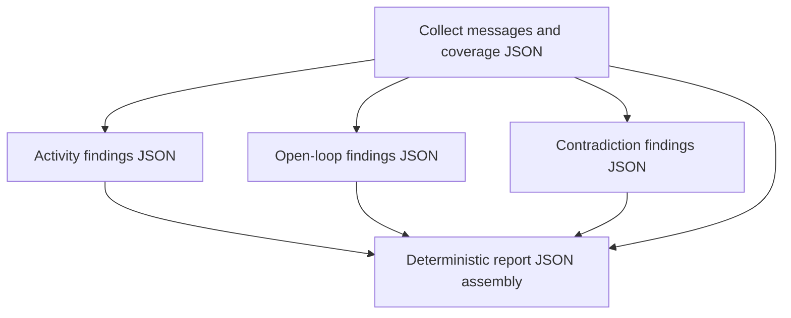

# Pipelines: deferred design specification

Status: someday idea, recorded November 13, 2026; design decisions selected by
the owner November 14, 2026. Not approved for implementation, inference tests or
scheduling. This document describes future behavior, not current functionality.

## Purpose

A pipeline coordinates existing agents and executables through JSON files and a
fixed dependency graph. Each stage performs focused work in a fresh context;
files carry evidence and findings between stages. A supervisor can inspect each
sub-run, identify a failed stage and retry it without repeating successful work.
The quality benefit must justify the extra inference and orchestration.

## Selected decisions

These selections supersede the alternatives in the initial exploration. Numbers
match the owner's initial 30-question questionnaire; follow-up answers supersede
earlier choices where noted below.

| # | Topic | Decision |
| --- | --- | --- |
| 1 | Stage types | Agents and executables. |
| 2 | Graph changes | Graph fixed before execution; agents cannot change it. |
| 3 | Refinement | Explicit draft, critique and revision stages; no cycles. |
| 4 | Agent configuration | Reference an existing agent; any agent setting may be overridden, including tools and skills. |
| 5 | Initial snapshots | Snapshot agent, skill and tool configurations when the pipeline first starts executing. |
| 6 | Retry configuration | Always use the latest configuration for a failed stage's retry. |
| 7 | Inputs | Named, schema-validated parameters plus optional attachments. |
| 8 | Triggers | Manual CLI/HTTP submission and existing timer/cron triggers. |
| 9 | Overlap | Queue a separate execution with its own workspace. |
| 10 | Conversation | Each stage starts fresh with instructions and artifact references. |
| 11 | Read scope | Current execution artifacts; executions do not rely on previous artifacts (follow-up supersedes earlier history access). |
| 12 | Output location | All outputs belong in the pipeline run folder; agents own nested sub-runs inside it. |
| 13 | Context loading | Artifact manifests and bounded reading tools; load on demand. |
| 14 | Evidence | Distinguish immutable sources from derived findings; preserve provenance. |
| 15 | Formats | All pipeline and stage input/output is JSON. |
| 16 | Publication | Successful completion, required files present and declared structural checks passing. |
| 17 | Partial output | Dependents wait for the complete upstream output set to be published. |
| 18 | Artifact mutation | Downstream stages cannot edit upstream artifacts; they can duplicate them into their own outputs. |
| 19 | Upstream revisions | No replacement of published upstream outputs within an execution. |
| 20 | Failure | Pause the whole pipeline for supervisor review. |
| 21 | Partial success | Never publish a successful final result unless every stage succeeds. |
| 22 | Automatic retries | No automatic stage retries (follow-up supersedes earlier policy); one tool-free output repair is allowed. |
| 23 | Pause | Stop new admissions and interrupt active stages using normal recovery. |
| 24 | Restart | Reconcile and automatically resume unfinished work under normal scheduling rules. |
| 25 | Scheduling preference | Prefer a started pipeline until it finishes. |
| 26 | Concurrency | One active pipeline stage across the entire daemon, including executables. |
| 27 | Execution budgets | Per-stage limits only. |
| 28 | Retention | Store everything; no automatic artifact or scratch cleanup. |
| 29 | Final assembly | Deterministic assembly, without a final model introducing interpretations. |
| 30 | Side effects | Permitted in any stage whose configured tools allow them. |

## Definitions and execution identity

A reusable pipeline definition contains a directed acyclic graph, named input
schema, stage references, agent-setting overrides and declared JSON outputs.
Definitions are JSON files managed through Nightcrew CLI/HTTP. An
execution is a parent run with a unique ID and nested stage sub-runs. Agent stages
reuse ordinary transcripts, tools, skills, interruption recovery and compaction;
executables receive JSON on stdin, return their JSON result on stdout, and may
write declared JSON artifacts in their sub-run folder. Diagnostics belong on stderr. Do not duplicate inference
or scheduling infrastructure merely to support pipelines.

Validate stage identities, dependencies, cycles, agent references, output ownership
and input declarations before admitting work, and revalidate at first execution.
Freeze the graph at first execution, not submission: queued runs pick up pipeline
definition changes. If queued inputs no longer satisfy the definition, hold with
a clear validation error rather than silently adapting them.
Snapshot referenced configurations when the pipeline first starts; queued work
therefore sees configuration edits made before that point. Record the exact
configuration used by every attempt. Failed-stage retries use the latest agent,
skill and tool configuration while keeping the graph and already published inputs
unchanged. Updated configuration that violates the stage's declared contract must
be rejected rather than silently changing that contract. Apply the execution’s
original stage overrides over the latest base agent configuration on retry; do
not pick up later pipeline-definition edits. Every agent setting can be overridden,
including tools and skills, subject to ordinary configuration validation.

Each stage begins with a fresh conversation. It receives instructions, validated
JSON input and an artifact manifest; it does not inherit another stage's entire
transcript. Bounded tools load needed content on demand. Compaction must preserve
artifact identities, read progress and evidence references.

## Parent run folder and artifacts

All execution outputs reside under the parent run, with stage-owned sub-runs.
An illustrative layout, not yet a path/schema contract:

```text
runs/<pipelineRunID>/
  state.json
  input.json
  sub-runs/<stageRunID>/
    state.json
    attempts/<attemptID>/
      input.json
      output.json
      artifacts/<name>.json
  output.json
```

No separate mutable global workspace is needed. Attempts keep their own work;
retries do not overwrite earlier evidence. The exact nesting for transcripts,
executable stages and unpublished scratch files needs implementation design. Each
sub-run has a globally unique run ID addressable by ordinary runs commands, with
its parent pipeline run and stage exposed in metadata.

All boundary inputs and outputs are JSON, including the final assembled result.
Human-readable prose can be carried in JSON string fields. Attachments reference
existing external files without copying their contents into the run. Record the
reference and observed identity/checksum when consumed; retention of the run does
not preserve external bytes or guarantee those paths remain available. Missing or
changed attachments must be surfaced rather than silently treated as unchanged.
Exact external-file validation and access rules remain implementation details.
This does not change existing Nightcrew transcript storage formats. Markdown is
not a standalone stage output; a presentation layer may render the JSON.

Every stage output must have a declared JSON schema and pass validation before
publication. Output declarations are frozen with the graph; do not introduce new
output files/declarations during execution. This interprets the owner's answer
“shouldnt be filed declared while a pipleine is executing” as advance declaration,
not prohibition of writing already declared files. Variable-length data can use
arrays within declared JSON outputs. Private scratch files are not handoff outputs.

Published artifacts are immutable. A downstream stage may read or duplicate an
artifact and produce a derived artifact in its own sub-run, preserving its source
identity. It cannot modify the producer's file. A producer publishes once; there
is no in-place upstream revision, stale-descendant mechanism or automatic rewrite
of a completed analysis. A deliberate new analysis belongs to a new execution.
An explicit refinement stage produces its own new output without replacing the
previous stage's work.

Only publish after stage success, required output presence and declared structural
checks. Make the complete output set visible atomically, with producer identity,
size and checksum metadata. Scratch files or partial writes are not published
inputs. A crash around publication must be reconciled before any dependent starts.

Each execution is self-contained and does not rely on prior executions' artifacts.
The current design omits historical artifact discovery and automatic history
injection for stages. This follows the owner's later “it shouldnt rely on previous
artifacts” answer rather than the earlier cross-execution access choice. Historical
runs remain retained and inspectable by supervisors. Unpublished artifacts from
another stage are not available for dependency bypass.

Managed workspace access should reject traversal, escaping symlinks and writes
outside the stage's owned files. External executables still have the local user's
permissions: these helpers are not an OS sandbox. Keep credentials out of shared
artifacts and treat retrieved content as untrusted data.

Retain all run state, transcripts, attempts, intermediate outputs, final outputs
and scratch evidence. There is no automatic age-based cleanup or success-based
pruning. Bounded reads protect context and memory without deleting retained files.
Insufficient disk space pauses the pipeline, preserves existing files, and permits
resume only when capacity is available. Disk admission checks and atomic recovery
need implementation design; do not delete evidence automatically to make room.

## Dependencies and scheduling

A stage is ready only after all dependencies publish successfully. Branches express
independent dependencies, not parallel execution: at most one pipeline stage across
the entire daemon is active, including executable stages. A waiting coordinator occupies
no inference slot.

Prefer a started pipeline over unrelated background work until it finishes. Human
instant requests, presence requirements and cooldown retain priority; pipeline
preference does not bypass them. A paused pipeline should not reserve a model slot
or prevent other eligible work indefinitely. Continue the earliest-started eligible
pipeline until it finishes or pauses. Within it, select ready stages in their
explicit definition order. Existing global capacity rules still apply to other
workloads; the pipeline-stage cap is an additional restriction.

Manual and timer/cron triggers can submit executions. Overlapping submissions
create separate queued parent runs and separate folders. Existing no-catch-up
schedule behavior should remain consistent unless explicitly revised later.
No actual trigger is installed or enabled by this specification.

Only per-stage execution budgets are configured. Do not add a pipeline-wide active
time budget or wall-clock deadline. Paused time does not count toward stage active
time, consistent with normal Nightcrew runs. Each explicit retry receives a fresh
active-time budget. Output repair is part of its current attempt, not a fresh stage
retry. Track total historical usage for inspection without imposing an aggregate
pipeline budget. Restart/interruption resume does not itself reset attempt time.

## Failure, retry, pause and restart

An unrecovered stage failure pauses the entire pipeline for supervisor review,
including independent branches. Pausing stops admission and interrupts any active
stage using normal recoverable interruption. No partial final report is published
as success: every stage must succeed. Intermediate results remain inspectable.

There are no automatic stage retries, even for transient failures. The owner's
later explicit “no automatic retries” answer supersedes the preceding choice to
retry safe failures before pausing. Invalid JSON or schema-invalid model output
has one specific exception: one tool-free repair using the validation error, with
original output retained. If repair fails, pause for review. Do not rerun the whole
stage or replay tools as output repair. Executable failures pause for review.

Retry failed work with the latest configuration and the same published inputs.
Keep each attempt and its actual configuration. Successful stages and their
artifacts are not rerun or replaced. A changed configuration may change a retry's
behavior, so status must make that configuration difference visible. Once the
supervisor fixes and resumes a failed pipeline, retry its failed stage, then
automatically continue the remaining graph after success.

After restart, reconcile durable parent/sub-run identities, active attempts and
publication before resuming automatically under normal scheduling rules. Do not
create duplicate sub-runs or replay completed work. Automatic restart recovery
must preserve explicit user pauses and failure-review holds; it is not permission
to clear them. Cancellation should stop new admission and active work while
retaining all recorded evidence. Cancellation is terminal and cannot be resumed;
use pause for recoverable stops or submit a new execution after cancellation.

Any stage can perform side effects permitted by its configured tools. Delivery is
not restricted to a special terminal stage. This makes attempt-level evidence,
idempotency and unknown-outcome handling necessary throughout the pipeline. A
later failure does not undo earlier sends or other external changes. No automatic
rollback is implied, and resuming or retrying must not blindly repeat those actions.
Tools declare read-only, idempotent mutation, or non-idempotent mutation behavior
for recovery decisions, not sandbox enforcement. This is a proposed future metadata
contract, not a claim about current tool fields. An external action with unknown
outcome pauses work until supervisor or tool-specific reconciliation establishes
the outcome; even an idempotent classification does not authorize automatic retry.

## Example: Discord briefing



Run the ready branches sequentially. All reviewers can read the same original
messages; summaries and bullet points are derived evidence, not replacements for
sources. The analysis uses the current execution’s evidence.
A contradiction requires paired incompatible claims; an open loop requires checking
later messages for resolution. These domain rules belong in the agents and tools.

A user-provided executable owns deterministic final assembly rules and returns
schema-valid JSON. Preserve conflicting findings with stage/source attribution;
do not choose a winner or silently drop a conflict. Any
ordering or deduplication must use explicit deterministic rules and preserve source
references and qualifications. It must not silently adjudicate conflicting claims.
Coverage combines collector metadata with actual read progress; availability of a
file alone does not prove that an agent reviewed it.

## Management and remaining design work

Future management needs definition CRUD/validation, submission/status, graph and
artifact inspection, pause/resume/cancel and stage retry. Shared oRPC contracts
must drive CLI, HTTP and TypeScript. No command names or wire schemas are finalized.
Status should expose dependencies, nested runs, attempts, actual configuration,
consumed artifacts, publication state, active time, side effects and review holds.
Store lifecycle facts in run files rather than duplicating them in daemon logs.

Remaining implementation details, without reopening the selected policies:

- Concrete JSON schemas, command names, definition identity and revision checks.
- External attachment references, changed-file detection and permitted paths.
- Nested-run layout/indexing and atomic output publication/restart reconciliation.
- Executable exit/status conventions and validation diagnostics.
- Precise tool-effect metadata and side-effect reconciliation interfaces.
- Storage admission thresholds and safe disk-full handling.

Follow-up decisions also establish that graph/configuration snapshots happen at
first execution; queued definitions can therefore change. Original stage overrides
remain fixed on retries over the latest agent configuration. Artifact declarations
are fixed before work begins. Stage output schemas are mandatory, separate from
semantic correctness. No additional implementation approval is implied.

Dynamic delegation, graph mutation, cycles, concurrent pipeline stages, partial
success, upstream output replacement, automatic stage retries, automatic cleanup
and model-based final
assembly are outside the selected design.

## Evaluation before implementation

Compare a single combined briefing agent with a manually orchestrated fixed pipeline
using the same frozen messages. Record all active time, including compaction, even
though only per-stage limits are configured. Compare supported findings, missed
resolutions, false contradictions, citations, coverage accuracy, duplication and
usefulness. Include windows with no contradictions and with explicit corrections.
Check that original evidence allows a specialist to catch upstream summary mistakes.
Account for model variability rather than trusting one successful report.

If the benefit justifies implementation, test publication crashes, failure pauses,
restart reconciliation, immutable output enforcement, external-file changes, retry
configuration refresh, sequential scheduling, retention and side-effect recovery.
This document authorizes no implementation, model test or scheduled execution.
